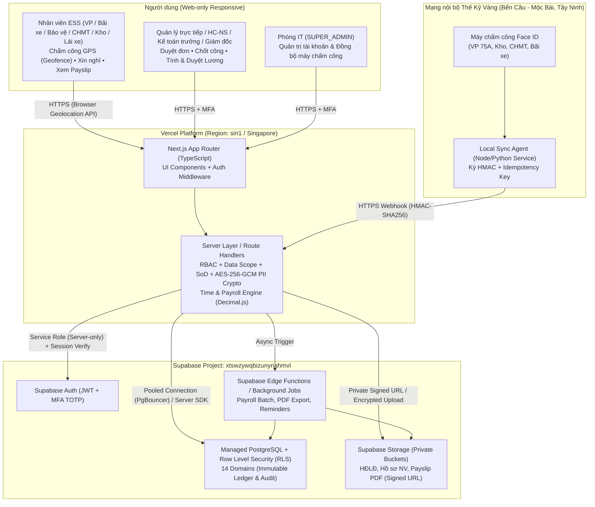

# DOC-14: Kiến trúc Hệ thống, Tech Stack & Hạ tầng Triển khai (Vercel + Supabase)

> **Trạng thái tài liệu:** `APPROVED_ARCHITECTURE_BASELINE` (Đã cập nhật theo hạ tầng mục tiêu của **Công ty TNHH Thương mại Thế Kỷ Vàng**)  
> **Tham chiếu gốc:** [HRM_Enterprise_Design_Baseline_v1.0.docx](../../HRM_Enterprise_Design_Baseline_v1.0.docx) — Mục 7; [DOC-24_Open_Decisions_Log.md](./DOC-24_Open_Decisions_Log.md) (`OD-05`, `OD-08`, `OD-12`, `OD-13`)  
> **Target Supabase Project:** `xtswzywqbizunynahmvl` (`https://supabase.com/dashboard/project/xtswzywqbizunynahmvl`)  
> **Target Web Hosting:** Vercel

---

## 1. Sơ đồ Kiến trúc Tổng thể (Modular Monolith trên Vercel + Supabase)



---

## 2. Tech Stack Chuẩn Đề Xuất cho Thế Kỷ Vàng (100–300 NV, 18 Phân hệ)

| Tầng | Công nghệ đề xuất | Lý do lựa chọn & Tương thích |
| :--- | :--- | :--- |
| **Web Framework** | **Next.js (App Router) + TypeScript** | Chạy native trên **Vercel**, tách rõ Server Components/Route Handlers (service layer privileged) khỏi Client Components |
| **UI & Design System** | **Tailwind CSS + shadcn/ui + Lucide Icons** | Responsive tốt cho cả màn hình desktop Văn phòng/Kế toán lẫn điện thoại di động khi nhân viên Bãi xe/Lái xe/CHMT chấm công GPS & xin nghỉ |
| **Database & ORM** | **Supabase PostgreSQL + Prisma hoặc Drizzle ORM** | Type-safe schema & migration, hỗ trợ tốt `DECIMAL/NUMERIC(18,2)` và `TIMESTAMPTZ` |
| **Precision Math (Payroll)** | **`decimal.js` / `big.js`** | Tuyệt đối không dùng IEEE-754 `number` (float) cho tiền lương, thuế TNCN, BHXH; đảm bảo khớp `0đ` với bộ `GTC-01` → `GTC-10` |
| **Authentication & MFA** | **Supabase Auth (Email/Password + TOTP MFA)** | Hỗ trợ MFA bắt buộc cho `SUPER_ADMIN`, `HR_ADMIN`, `ACCOUNTANT`, `DIRECTOR`, `AUDITOR`; lưu phiên bảo mật (`HttpOnly` Cookie via `@supabase/ssr`) |
| **Authorization & Security** | **Server Service Layer RBAC/SoD + PostgreSQL RLS + AES-256-GCM** | Đảm bảo quy tắc Baseline: *"Browser không được gọi trực tiếp thao tác privileged"* |
| **Background Jobs & Export** | **Supabase Edge Functions / Vercel Cron + Queue (Upstash/pg_boss hoặc chunked jobs)** | Tránh giới hạn serverless timeout của Vercel khi chạy payroll 300 người, xuất PDF payslip hàng loạt hoặc gửi Email thông báo |
| **Validation & Testing** | **Zod + Vitest + Playwright** | Validate đầu vào chặt chẽ; chạy tự động 100% Golden Test Cases (`GTC-01` → `GTC-10`) trong CI |

---

## 3. Thiết kế Chi tiết 3 Bổ sung Đặc thù (`12/11/2026`)

### 3.1. Chấm công Đa kênh: GPS (Geofencing) + Máy chấm công Face ID
1. **Chấm công GPS (Web/Mobile Browser):**
   * Khi nhân viên bấm `Check-in` / `Check-out`, trình duyệt gọi `navigator.geolocation.getCurrentPosition({ enableHighAccuracy: true })`.
   * **Không tracking vị trí nền:** Tọa độ chỉ gửi lên server đúng 1 lần tại thời điểm bấm nút.
   * Server tính khoảng cách **Haversine** từ `(gps_lat, gps_lng)` đến tọa độ của `location` được phân công (`VP 75A`, `Kho hàng`, `CHMT Mộc Bài`, `Bãi xe Điểm tập kết`) hoặc cho phép gắn cờ `REMOTE_DUTY` (đối với Lái xe đi giao/đón khách ngoài địa bàn).
   * Nếu `distance_m > geofence_radius_m` hoặc `gps_accuracy_m` quá lớn: hệ thống vẫn **ghi nhận raw event bất biến**, đánh dấu `is_within_geofence = FALSE` và tự động đẩy sang `attendance_exceptions` để Quản lý trực tiếp (`Quản lý Bãi xe` / `Thủ kho` / `Cửa hàng trưởng` / `Trưởng phòng`) kiểm duyệt giải trình.
2. **Máy chấm công Face ID (Tại 4 điểm làm việc):**
   * Máy chấm công thực hiện đối sánh khuôn mặt **cục bộ trên thiết bị**; **không gửi hay lưu ảnh/embedding sinh trắc học lên Supabase** (giảm tối đa rủi ro lộ dữ liệu sinh trắc học theo Luật `91/2025/QH15`).
   * **Local Sync Agent** (chạy tại server/PC mạng nội bộ do Phòng IT Thế Kỷ Vàng quản trị) định kỳ (VD mỗi 1–5 phút) đọc log từ các máy Face ID qua LAN → đẩy batch về endpoint `/api/integrations/attendance/face-id-events` trên Vercel với chữ ký `X-Signature-HMAC` và `idempotency_key = sha256(device_code + device_user_id + event_time)`.
   * Hỗ trợ **Import Excel dự phòng** nếu mạng nội bộ tại điểm tập kết bị gián đoạn tạm thời.
3. **Tuân thủ Luật `91/2025/QH15`:**
   * Lần đầu sử dụng chấm công GPS hoặc đăng ký Face ID, nhân viên phải đọc thông báo xử lý dữ liệu và xác nhận đồng ý (`consent_records` với `purpose_code = 'ATTENDANCE_GPS'` và `'ATTENDANCE_BIOMETRIC_FACE_ID'`).

### 3.2. Cấu trúc Tiền ăn & Phụ cấp Linh hoạt theo Bộ phận và Cá nhân (3 Tầng)
Để giải quyết yêu cầu *"tiền ăn và phụ cấp tùy theo bộ phận, tùy người không có cố định"*, Payroll Engine áp dụng thứ tự ưu tiên phân giải (**Precedence Order**):

```text
Tầng 3: Biến động kỳ lương (payroll_period_variables) — cộng thêm hoặc ghi đè riêng tháng đó
   ↓ (nếu không có)
Tầng 2: Ghi đè cá nhân (employee_allowance_overrides) — gán riêng cho từng nhân viên
   ↓ (nếu không có)
Tầng 1: Chính sách bộ phận/chức danh (department_allowance_policies) — mặc định của bộ phận
```

* Hỗ trợ đa dạng phương thức tính (`calc_mode`):
  * `FIXED_MONTHLY`: Cố định tháng (có thể chọn `is_prorated = true/false` theo công thực tế).
  * `PER_WORKDAY`: Nhân theo ngày công thực tế (ví dụ: tiền ăn trưa `40.000đ × số ngày công`, tối ưu cho ca Bãi xe/CHMT/Bảo vệ).
  * `VARIABLE_INPUT`: Nhập/import biến động hàng tháng (thưởng doanh số CHMT, thưởng KPI, hỗ trợ phát sinh).
* **Quy tắc Thuế TNCN tự động (NĐ `253/2026/NĐ-CP`):** Bất kể cấu hình theo bộ phận hay từng người, engine gom tổng các khoản có mã nhóm `LUNCH_CASH` của từng nhân viên trong kỳ → miễn thuế `min(tong_tien_an_ca_tien_mat, 1.200.000)` và tự động đưa phần vượt vào thu nhập chịu thuế.

### 3.3. Kiến trúc Bảo mật & Vận hành trên Vercel + Supabase (`xtswzywqbizunynahmvl`)
1. **Không lộ dữ liệu qua Supabase Public API (`anon key`):**
   * Bật **RLS (`ENABLE ROW LEVEL SECURITY`)** trên **tất cả các bảng** tại project `xtswzywqbizunynahmvl`; mặc định **từ chối mọi truy cập trực tiếp từ `anon` role** và siết chặt policy cho `authenticated` role theo `employee_id = auth.uid()` (chỉ đọc tự phục vụ khi cần).
   * Mọi luồng nghiệp vụ đọc/ghi/tính lương/xuất file chạy qua **Vercel Server API** dùng `SUPABASE_SERVICE_ROLE_KEY` (chỉ tồn tại ở Server Environment Variables, không bao giờ đưa vào `NEXT_PUBLIC_*`).
2. **Mã hóa Trường nhạy cảm (`HIGH_PII`):**
   * Các trường `national_id_enc` (CCCD/CMND), `account_no_enc` (STK ngân hàng), `tax_code_enc` (MST cá nhân), `phone_enc` được mã hóa `AES-256-GCM` tại Service Layer Vercel trước khi ghi xuống Postgres Supabase; kèm cột `*_hash` (HMAC-SHA256) phục vụ tìm kiếm/check trùng chính xác mà không lộ dữ liệu thô trong DB.
3. **Storage An toàn:**
   * Toàn bộ file hợp đồng, giấy tờ tùy thân, chứng từ nghỉ ốm/thai sản, phiếu lương PDF lưu trong **Private Buckets** trên Supabase Storage; trình duyệt chỉ nhận **Signed URL ngắn hạn (60–300 giây)** sau khi server xác thực đủ RBAC + ghi `access_logs`.
4. **Checklist Vận hành & Pháp lý trước Go-Live Supabase + Vercel:**
   * Kiểm tra Region của Supabase project `xtswzywqbizunynahmvl` và cấu hình Vercel Function Region tại **Singapore (`sin1` / `ap-southeast-1`)** để đạt độ trễ thấp nhất về Tây Ninh.
   * Kích hoạt **Daily Automated Backup / PITR** trên Supabase để đạt `RPO ≤ 1h, RTO ≤ 4h`.
   * Hoàn tất **Hồ sơ Đánh giá tác động xử lý & chuyển dữ liệu cá nhân ra nước ngoài** (nộp/lưu theo Luật `91/2025/QH15` & NĐ `356/2025/NĐ-CP`) vì dữ liệu lưu trên hạ tầng cloud Supabase/Vercel đặt ngoài lãnh thổ Việt Nam.

