# DOC-15: Thiết kế Cơ sở dữ liệu & ERD (Conceptual → Logical Schema)

> **Trạng thái tài liệu:** `DRAFT_FOR_REVIEW` (Chỉ dùng cho review thiết kế Phase 0; **không tạo migration** khi chưa có phê duyệt)  
> **Hệ quản trị CSDL mục tiêu:** PostgreSQL (Managed)  
> **Tham chiếu gốc:** [HRM_Enterprise_Design_Baseline_v1.0.docx](../../HRM_Enterprise_Design_Baseline_v1.0.docx) — Mục 8

---

## 1. Quy ước thiết kế dữ liệu bắt buộc (Data Design Rules)

1. **Primary Key:** `UUID` (khuyến nghị UUIDv7 để tối ưu B-Tree index theo thời gian) cho toàn bộ bảng chính.
2. **Tiền tệ & Số thập phân:**
   * Số tiền: `NUMERIC(18, 2)` kèm `currency_code CHAR(3) DEFAULT 'VND'`.
   * Tỷ lệ / hệ số / giờ công: `NUMERIC(10, 4)` (ví dụ hệ số OT `1.5000`, `2.7000`; tỷ lệ BHXH `0.0800`).
   * Tuyệt đối **không dùng** `FLOAT` / `DOUBLE PRECISION` cho tiền, công, thuế, bảo hiểm.
3. **Thời gian & Múi giờ:** Mọi cột timestamp dùng `TIMESTAMPTZ` (lưu UTC); tầng hiển thị chuyển đổi sang `Asia/Ho_Chi_Minh`. Cột ngày nghiệp vụ (ngày sinh, ngày hiệu lực hợp đồng, ngày công) dùng `DATE`.
4. **Effective Dating & Immutability:**
   * Các bảng chính sách/lương/hợp đồng/phân bổ đơn vị dùng `effective_from DATE NOT NULL`, `effective_to DATE NULL` (có constraint chống chồng lấn khoảng hiệu lực nếu thuộc chuỗi nối tiếp).
   * **Không hard-delete** dữ liệu liên quan hợp đồng, lương, thuế, bảo hiểm, chấm công gốc, audit log.
   * `attendance_raw_events`, `payroll_run_inputs`, `payroll_results`, `payslips`, `audit_events` là **bất biến (append-only / immutable)**.
5. **Single Enterprise nhưng rõ phạm vi:** Mọi bảng nghiệp vụ mang `company_id UUID NOT NULL REFERENCES companies(id)` để nhất quán ranh giới pháp nhân (không phát triển thành SaaS multi-tenant).
6. **Bảo vệ dữ liệu cá nhân (Luật `91/2025/QH15` & NĐ `356/2025/NĐ-CP`):**
   * Các trường nhạy cảm (`national_id_no`, `tax_code`, `bank_account_no`) lưu kèm phiên bản mã hóa ở application/KMS layer (`*_encrypted`) + hash tìm kiếm (`*_hash`) nếu cần tra cứu trùng lặp.
   * Bổ sung cụm bảng `consent_records`, `data_subject_requests`, `legal_holds` gắn với `retention_policies`.

---

## 2. Sơ đồ quan hệ tổng thể (Core Domains ERD)

```mermaid
erDiagram
    companies ||--o{ locations : has
    companies ||--o{ departments : has
    companies ||--o{ employees : employs
    departments ||--o{ departments : parent_of
    employees ||--o{ org_assignments : assigned_to
    departments ||--o{ org_assignments : contains
    positions ||--o{ org_assignments : defines
    locations ||--o{ org_assignments : located_at

    employees ||--o{ contracts : signs
    contracts ||--o{ contract_amendments : amended_by
    contracts ||--o{ salary_assignments : sets_pay

    employees ||--o{ attendance_raw_events : clocks
    employees ||--o{ attendance_sessions : generates
    shift_templates ||--o{ shift_assignments : schedules
    employees ||--o{ shift_assignments : works
    employees ||--o{ leave_requests : submits
    employees ||--o{ overtime_requests : requests

    payroll_periods ||--o{ payroll_runs : executes
    payroll_runs ||--o{ payroll_run_inputs : snapshots
    payroll_runs ||--o{ payroll_results : produces
    payroll_results ||--o{ payroll_items : itemizes
    payroll_results ||--o{ payslips : issues
    payroll_runs ||--o{ payroll_adjustments : adjusts

    employees ||--o{ tax_profiles : has
    employees ||--o{ tax_dependents : declares
    employees ||--o{ insurance_profiles : participates
    legal_rule_registry ||--o{ tax_brackets : defines
    legal_rule_registry ||--o{ insurance_rules : defines

    users ||--o{ user_roles : has
    roles ||--o{ role_permissions : grants
    permissions ||--o{ role_permissions : mapped_to
    users ||--o{ data_scopes : scoped_by
```

---

## 3. Đặc tả chi tiết các bảng theo 14 Domains

### Domain 1: Identity, Access & Privacy Compliance
| Bảng | Các cột cốt lõi | Ghi chú / Ràng buộc |
| :--- | :--- | :--- |
| `users` | `id`, `company_id`, `employee_id (NULLABLE)`, `email (UNIQUE)`, `password_hash`, `mfa_enabled`, `mfa_secret_enc`, `status`, `last_login_at` | Tách tài khoản đăng nhập với hồ sơ `employees` (hỗ trợ tài khoản hệ thống/auditor không phải NV) |
| `roles` | `id`, `code (UNIQUE)`, `name`, `is_system`, `description` | 8 role chuẩn: `SUPER_ADMIN`, `HR_ADMIN`, `HR_STAFF`, `DEPARTMENT_MANAGER`, `ACCOUNTANT`, `DIRECTOR`, `EMPLOYEE`, `AUDITOR` |
| `permissions` | `id`, `module_code`, `resource`, `action`, `sensitivity_level` | Phân tách `READ`, `WRITE`, `APPROVE`, `LOCK`, `EXPORT`, `UNMASK_PII` |
| `role_permissions` | `role_id`, `permission_id` | PK kép `(role_id, permission_id)` |
| `user_roles` | `id`, `user_id`, `role_id`, `effective_from`, `effective_to`, `granted_by` | Hỗ trợ 1 user có nhiều role có thời hạn |
| `data_scopes` | `id`, `user_id`, `role_id`, `scope_type`, `scope_ref_id`, `effective_from`, `effective_to` | `scope_type`: `SELF`, `DEPARTMENT_TREE`, `LOCATION`, `COMPANY` |
| `sessions` | `id`, `user_id`, `token_hash`, `ip_address`, `user_agent`, `expires_at`, `revoked_at` | Quản lý session, force logout khi thu hồi quyền/offboarding |
| `mfa_events` | `id`, `user_id`, `event_type`, `status`, `ip_address`, `created_at` | Theo dõi xác thực MFA của các vai trò đặc quyền |
| `consent_records` | `id`, `company_id`, `subject_type` (`EMPLOYEE`/`CANDIDATE`), `subject_id`, `purpose_code`, `policy_version`, `consent_method`, `consented_at`, `withdrawn_at`, `evidence_file_id` | Bắt buộc theo Luật BVDLCN `91/2025/QH15` & NĐ `356/2025/NĐ-CP` |
| `data_subject_requests` | `id`, `company_id`, `employee_id`, `request_type` (`ACCESS`/`RECTIFY`/`DELETE`/`RESTRICT`), `status`, `due_at`, `handled_by`, `resolution_note` | Quy trình tiếp nhận & xử lý yêu cầu chủ thể dữ liệu |
| `legal_holds` | `id`, `company_id`, `target_entity`, `target_id`, `reason`, `legal_basis`, `active`, `created_by`, `released_at` | Chặn xóa/ẩn danh hóa dữ liệu đang bị giữ theo luật lao động/thuế/kế toán |

### Domain 2: Organization Management
| Bảng | Các cột cốt lõi | Ghi chú / Ràng buộc |
| :--- | :--- | :--- |
| `companies` | `id`, `code`, `legal_name`, `tax_code`, `address`, `default_currency`, `timezone` | `timezone DEFAULT 'Asia/Ho_Chi_Minh'` |
| `locations` | `id`, `company_id`, `code`, `name`, `address`, `min_wage_region_code` (`I`/`II`/`III`/`IV`), `latitude NUMERIC(10,7)`, `longitude NUMERIC(10,7)`, `geofence_radius_m INT`, `gps_required BOOLEAN`, `effective_from`, `effective_to` | Xác định vùng lương tối thiểu **và** tọa độ Geofence chấm công GPS cho 4 điểm làm việc (`VP 75A`, `Kho`, `CHMT`, `Bãi xe`) |
| `departments` | `id`, `company_id`, `parent_id`, `code`, `name`, `manager_employee_id`, `cost_center_id`, `status`, `effective_from`, `effective_to` | Hỗ trợ cây phòng ban nhiều cấp |
| `positions` | `id`, `company_id`, `code`, `title`, `job_grade_id`, `headcount_limit`, `allow_300h_ot` | `allow_300h_ot DEFAULT FALSE` |
| `job_grades` | `id`, `company_id`, `code`, `name`, `rank_order` | Cấp bậc chức danh |
| `cost_centers` | `id`, `company_id`, `code (UNIQUE)`, `name`, `accounting_ref` | Phục vụ đối soát chi phí lương với Kế toán |
| `org_assignments` | `id`, `company_id`, `employee_id`, `department_id`, `position_id`, `location_id`, `cost_center_id`, `manager_id`, `is_primary`, `effective_from`, `effective_to` | Lịch sử điều chuyển/kiêm nhiệm theo thời gian |

### Domain 3: Employee Core
| Bảng | Các cột cốt lõi | Ghi chú / Ràng buộc |
| :--- | :--- | :--- |
| `employees` | `id`, `company_id`, `employee_code (UNIQUE)`, `full_name`, `dob`, `gender`, `nationality`, `is_foreign_worker`, `national_id_enc`, `national_id_hash (UNIQUE)`, `work_email`, `employment_status`, `hire_date`, `probation_end_date`, `termination_date` | `employment_status`: `ONBOARDING`, `PROBATION`, `ACTIVE`, `ON_LEAVE`, `TERMINATED` |
| `employee_contacts` | `id`, `employee_id`, `phone_enc`, `personal_email`, `emergency_contact_name`, `emergency_contact_phone` | Thông tin liên hệ |
| `employee_addresses` | `id`, `employee_id`, `address_type` (`PERMANENT`/`CURRENT`), `full_address`, `province_code`, `ward_code` | Không dùng để suy ra vùng lương |
| `employee_dependents` | `id`, `employee_id`, `full_name`, `relationship`, `dob`, `national_id_enc`, `is_tax_dependent`, `tax_effective_from`, `tax_effective_to`, `verification_status` | Liên kết sang `tax_dependents` để tính giảm trừ gia cảnh 6,2 triệu/tháng |
| `employee_education` | `id`, `employee_id`, `institution`, `degree`, `major`, `graduated_year` | Trình độ học vấn |
| `employee_skills` | `id`, `employee_id`, `skill_name`, `proficiency_level`, `certified_at` | Năng lực / kỹ năng |
| `employee_bank_accounts` | `id`, `employee_id`, `bank_code`, `bank_name`, `branch_name`, `account_no_enc`, `account_holder`, `is_primary`, `effective_from` | Tách riêng để giới hạn field-level permission |
| `employee_documents` | `id`, `employee_id`, `doc_type`, `file_id`, `issue_date`, `expiry_date`, `verification_status` | CCCD, giấy khám sức khỏe, bằng cấp, hộ chiếu/GPLĐ |

### Domain 4: Employment, Contracts & Movements
| Bảng | Các cột cốt lõi | Ghi chú / Ràng buộc |
| :--- | :--- | :--- |
| `contracts` | `id`, `company_id`, `employee_id`, `contract_no (UNIQUE)`, `contract_type` (`PROBATION`/`FIXED_TERM`/`INDEFINITE`/`PART_TIME`/`SEASONAL`), `signed_date`, `effective_from`, `effective_to`, `status`, `file_id` | Theo dõi ngày hết hạn, cảnh báo gia hạn |
| `contract_terms` | `id`, `contract_id`, `work_hours_per_day`, `work_days_per_week`, `probation_rate`, `notice_days`, `notes` | Điều khoản thời giờ làm việc & tỷ lệ hưởng thử việc |
| `contract_amendments` | `id`, `contract_id`, `amendment_no`, `effective_from`, `change_summary`, `status`, `file_id` | Phụ lục hợp đồng |
| `salary_assignments` | `id`, `company_id`, `employee_id`, `contract_id`, `pay_structure` (`GROSS`/`NET`), `base_salary NUMERIC(18,2)`, `si_salary_base NUMERIC(18,2)`, `allowance_json JSONB`, `effective_from`, `effective_to`, `approved_by`, `approved_at` | Nguồn dữ liệu chuẩn cho Payroll Engine |
| `employee_movements` | `id`, `company_id`, `employee_id`, `movement_type` (`HIRE`/`TRANSFER`/`PROMOTE`/`SALARY_CHANGE`/`TERMINATE`), `effective_date`, `from_snapshot JSONB`, `to_snapshot JSONB`, `decision_no`, `workflow_instance_id` | Nhật ký biến động nhân sự có phê duyệt |
| `employment_events` | `id`, `company_id`, `employee_id`, `event_type`, `event_date`, `payload JSONB`, `created_by` | Event log bất biến |

### Domain 5: Recruitment (ATS) & Onboarding/Offboarding
| Bảng | Các cột cốt lõi | Ghi chú / Ràng buộc |
| :--- | :--- | :--- |
| `job_requisitions` | `id`, `company_id`, `department_id`, `position_id`, `headcount`, `target_date`, `status`, `workflow_instance_id` | Kiểm tra định biên trước khi tuyển |
| `candidates` | `id`, `company_id`, `full_name`, `email`, `phone_enc`, `cv_file_id`, `source`, `consent_record_id`, `retention_until` | Áp dụng retention tự động ẩn danh/xóa ứng viên không trúng tuyển |
| `applications` | `id`, `requisition_id`, `candidate_id`, `stage`, `status`, `applied_at` | Theo dõi phễu ứng tuyển |
| `interviews` | `id`, `application_id`, `round_no`, `scheduled_at`, `interviewer_ids JSONB`, `status` | Lịch phỏng vấn |
| `evaluations` | `id`, `interview_id`, `evaluator_id`, `score`, `recommendation`, `notes` | Đánh giá ứng viên |
| `offers` | `id`, `application_id`, `proposed_salary NUMERIC(18,2)`, `pay_structure`, `start_date`, `status`, `workflow_instance_id`, `converted_employee_id` | Duyệt offer → chuyển đổi thành `employees` |
| `lifecycle_checklists` | `id`, `company_id`, `employee_id`, `checklist_type` (`ONBOARDING`/`OFFBOARDING`), `status`, `target_date` | Checklist đầu việc nhận việc / nghỉ việc |
| `lifecycle_checklist_items` | `id`, `checklist_id`, `title`, `owner_role`, `assigned_to`, `due_date`, `completed_at`, `evidence_note` | Theo dõi bàn giao tài khoản, tài sản, quyết toán |

### Domain 6: Time & Attendance
| Bảng | Các cột cốt lõi | Ghi chú / Ràng buộc |
| :--- | :--- | :--- |
| `shift_templates` | `id`, `company_id`, `code`, `name`, `start_time TIME`, `end_time TIME`, `is_overnight BOOLEAN`, `break_minutes INT`, `early_handover_minutes INT`, `count_early_handover_as_work BOOLEAN`, `standard_work_hours NUMERIC(6,2)`, `night_window_start TIME`, `night_window_end TIME` | Hỗ trợ ca qua ngày, tách giờ đêm `22:00–06:00` & tính giờ có mặt sớm giao ca (`Bảo vệ` 30', `Bãi xe` 15') vào công/OT |
| `work_calendars` | `id`, `company_id`, `location_id`, `calendar_date DATE`, `day_type` (`WORKDAY`/`WEEKEND`/`HOLIDAY`/`COMPENSATORY_OFF`), `holiday_name` | Phân biệt hệ số ngày thường / nghỉ tuần / lễ |
| `shift_assignments` | `id`, `company_id`, `employee_id`, `shift_template_id`, `work_date DATE`, `status`, `source` (`SCHEDULE`/`SWAP`) | Phân ca theo ngày |
| `attendance_devices` | `id`, `company_id`, `location_id`, `device_code (UNIQUE)`, `device_name`, `device_type` (`FACE_ID`), `vendor`, `serial_no`, `api_key_hash`, `last_sync_at`, `status` | Đăng ký máy chấm công nhận dạng khuôn mặt (`Face ID`) theo điểm làm việc |
| `attendance_raw_events` | `id`, `company_id`, `employee_id`, `event_time TIMESTAMPTZ`, `direction` (`IN`/`OUT`/`UNKNOWN`), `source_type` (`DEVICE_FACE_ID`/`WEB_GPS`/`QR`/`IMPORT`), `verify_mode` (`FACE_ID`/`GPS_GEOFENCE`/`MANUAL_CORRECTION`), `device_id`, `gps_lat NUMERIC(10,7)`, `gps_lng NUMERIC(10,7)`, `gps_accuracy_m NUMERIC(8,2)`, `distance_m NUMERIC(10,2)`, `is_within_geofence BOOLEAN`, `consent_record_id`, `idempotency_key (UNIQUE)`, `raw_payload JSONB`, `created_at` | **Bất biến (Append-only)**; chống trùng lặp bằng `idempotency_key`; không lưu ảnh/vector khuôn mặt thô nếu thiết bị tự nhận dạng |
| `attendance_sessions` | `id`, `company_id`, `employee_id`, `work_date DATE`, `shift_assignment_id`, `check_in_event_id`, `check_out_event_id`, `effective_in TIMESTAMPTZ`, `effective_out TIMESTAMPTZ`, `worked_hours NUMERIC(6,2)`, `late_minutes INT`, `early_minutes INT`, `night_hours NUMERIC(6,2)`, `status` | Phiên công ghép từ raw events hoặc sửa công đã duyệt |
| `attendance_exceptions` | `id`, `company_id`, `employee_id`, `work_date DATE`, `exception_type` (`MISSING_IN`/`MISSING_OUT`/`DUPLICATE`/`OUT_OF_SHIFT`), `session_id`, `explanation_note`, `status`, `workflow_instance_id` | Fail-safe: dữ liệu bất thường phải qua ngoại lệ, không tự đoán |
| `attendance_summaries` | `id`, `company_id`, `payroll_period_id`, `employee_id`, `version INT`, `standard_days NUMERIC(6,2)`, `paid_days NUMERIC(6,2)`, `unpaid_days NUMERIC(6,2)`, `ot_weekday_hours NUMERIC(6,2)`, `ot_weekend_hours NUMERIC(6,2)`, `ot_holiday_hours NUMERIC(6,2)`, `ot_night_hours NUMERIC(6,2)`, `is_locked BOOLEAN`, `locked_at`, `locked_by` | Bản tổng hợp công có `version` làm đầu vào cho Payroll |

### Domain 7: Leave & Overtime
| Bảng | Các cột cốt lõi | Ghi chú / Ràng buộc |
| :--- | :--- | :--- |
| `leave_types` | `id`, `company_id`, `code`, `name`, `is_paid BOOLEAN`, `si_benefit_paid BOOLEAN`, `requires_document BOOLEAN` | Phép năm, ốm, thai sản, việc riêng có lương, không lương |
| `leave_policies` | `id`, `company_id`, `leave_type_id`, `annual_quota NUMERIC(6,2)`, `accrual_method`, `seniority_bonus_years`, `carryover_cap NUMERIC(6,2)`, `carryover_expiry_month`, `effective_from`, `effective_to` | Cấu hình phép theo ngày hiệu lực |
| `leave_balances` | `id`, `company_id`, `employee_id`, `leave_type_id`, `year INT`, `entitled_days NUMERIC(6,2)`, `carried_over NUMERIC(6,2)`, `used_days NUMERIC(6,2)`, `adjusted_days NUMERIC(6,2)`, `pending_days NUMERIC(6,2)` | Kiểm tra số dư trước khi duyệt đơn |
| `leave_requests` | `id`, `company_id`, `employee_id`, `leave_type_id`, `start_at TIMESTAMPTZ`, `end_at TIMESTAMPTZ`, `total_days NUMERIC(6,2)`, `reason`, `attachment_file_id`, `status`, `workflow_instance_id` | Có audit log cho điều chỉnh số dư |
| `overtime_requests` | `id`, `company_id`, `employee_id`, `work_date DATE`, `start_at TIMESTAMPTZ`, `end_at TIMESTAMPTZ`, `requested_hours NUMERIC(6,2)`, `ot_day_type`, `employee_consent BOOLEAN`, `employee_consent_at TIMESTAMPTZ`, `status`, `workflow_instance_id` | Kiểm tra trần 40h/tháng, 200h hoặc 300h/năm |
| `overtime_records` | `id`, `company_id`, `overtime_request_id`, `employee_id`, `work_date DATE`, `actual_hours NUMERIC(6,2)`, `day_hours NUMERIC(6,2)`, `night_hours NUMERIC(6,2)`, `multiplier NUMERIC(6,4)`, `tax_exempt_multiplier NUMERIC(6,4)`, `verified_by` | Xác nhận giờ OT thực tế đối chiếu với chấm công |

### Domain 8: Payroll Engine (Gross/Net)
| Bảng | Các cột cốt lõi | Ghi chú / Ràng buộc |
| :--- | :--- | :--- |
| `salary_components` | `id`, `company_id`, `code (UNIQUE)`, `name`, `category` (`EARNING`/`ALLOWANCE`/`OT`/`BONUS`/`DEDUCTION`/`EMPLOYER_COST`/`ADJUSTMENT`), `calc_mode` (`FIXED_MONTHLY`/`PER_WORKDAY`/`PERCENT_BASE`/`VARIABLE_INPUT`/`FORMULA`), `is_taxable BOOLEAN`, `tax_exempt_rule_code`, `tax_exempt_cap NUMERIC(18,2)`, `is_si_base BOOLEAN`, `is_prorated BOOLEAN`, `formula_expression`, `effective_from`, `effective_to` | Cấu hình linh hoạt từng khoản tiền ăn, phụ cấp, thưởng |
| `department_allowance_policies` | `id`, `company_id`, `department_id`, `position_id (NULLABLE)`, `salary_component_id`, `default_amount NUMERIC(18,2)`, `calc_mode`, `effective_from`, `effective_to` | **Tầng 1:** Mức tiền ăn / phụ cấp mặc định tùy theo từng bộ phận / chức danh |
| `employee_allowance_overrides` | `id`, `company_id`, `employee_id`, `salary_component_id`, `override_amount NUMERIC(18,2)`, `calc_mode`, `reason`, `approved_by`, `effective_from`, `effective_to` | **Tầng 2:** Ghi đè mức tiền ăn / phụ cấp riêng theo từng cá nhân (không cố định) |
| `payroll_period_variables` | `id`, `company_id`, `payroll_period_id`, `employee_id`, `salary_component_id`, `amount NUMERIC(18,2)`, `quantity NUMERIC(10,4)`, `source` (`MANUAL`/`IMPORT`/`CHMT_POS`), `note`, `approved_by` | **Tầng 3:** Khoản phụ cấp / thưởng doanh số / ăn ca biến động riêng theo từng kỳ lương |
| `payroll_periods` | `id`, `company_id`, `period_code (UNIQUE)`, `period_month INT`, `period_year INT`, `start_date DATE`, `end_date DATE`, `cutoff_date DATE`, `advance_pay_date DATE`, `settlement_pay_date DATE`, `status` (`OPEN`/`ADVANCE_PAID`/`CLOSED`) | Chốt công ngày `25`; Đợt 1 chi ngày `15` (50% lương CB); Đợt 2 quyết toán ngày `cuối tháng` |
| `payroll_runs` | `id`, `company_id`, `payroll_period_id`, `run_type` (`MID_MONTH_ADVANCE`/`END_MONTH_SETTLEMENT`/`ADJUSTMENT`/`OFF_CYCLE`), `run_version INT`, `status` (`DRAFT`/`CALCULATED`/`REVIEWED`/`APPROVED`/`LOCKED`/`PAID`/`REOPENED`), `legal_rule_snapshot JSONB`, `created_by`, `approved_by`, `locked_at` | Tách rõ run chi ứng 50% ngày `15` và run quyết toán cuối tháng |
| `payroll_run_inputs` | `id`, `payroll_run_id`, `employee_id`, `salary_assignment_snapshot JSONB`, `attendance_summary_snapshot JSONB`, `tax_profile_snapshot JSONB`, `insurance_profile_snapshot JSONB`, `input_hash` | Đảm bảo **deterministic / idempotent** khi kiểm tra lại |
| `payroll_results` | `id`, `payroll_run_id`, `employee_id`, `cost_center_id`, `gross_income NUMERIC(18,2)`, `si_base_bhxh NUMERIC(18,2)`, `si_base_bhtn NUMERIC(18,2)`, `ee_insurance_total NUMERIC(18,2)`, `er_insurance_total NUMERIC(18,2)`, `tax_exempt_income NUMERIC(18,2)`, `assessable_income NUMERIC(18,2)`, `personal_deduction NUMERIC(18,2)`, `dependent_deduction NUMERIC(18,2)`, `taxable_income NUMERIC(18,2)`, `pit_amount NUMERIC(18,2)`, `other_deductions NUMERIC(18,2)`, `full_month_net NUMERIC(18,2)`, `mid_month_advance_paid NUMERIC(18,2)`, `net_payable NUMERIC(18,2)`, `negative_balance_carryover NUMERIC(18,2)`, `employer_total_cost NUMERIC(18,2)` | `net_payable` đợt cuối tháng = `max(0, full_month_net - mid_month_advance_paid)`; nếu âm ghi `negative_balance_carryover` để thu hồi |
| `payroll_items` | `id`, `payroll_result_id`, `salary_component_id`, `component_code`, `category`, `quantity NUMERIC(10,4)`, `rate NUMERIC(18,4)`, `amount NUMERIC(18,2)`, `tax_exempt_amount NUMERIC(18,2)`, `explanation_text` | Chi tiết từng dòng tính lương & giải thích Net-to-Gross |
| `payslips` | `id`, `payroll_result_id`, `employee_id`, `payroll_period_id`, `payslip_no (UNIQUE)`, `payload_snapshot JSONB`, `pdf_file_id`, `published_at` | Bất biến sau khi phát hành |
| `payroll_adjustments` | `id`, `company_id`, `original_payroll_run_id`, `adjustment_payroll_run_id`, `employee_id`, `reason`, `tax_impact_mode`, `si_impact_mode`, `approved_by` | Truy lĩnh / truy thu sau khóa kỳ |

### Domain 9: Tax, Insurance & Legal Rule Registry
| Bảng | Các cột cốt lõi | Ghi chú / Ràng buộc |
| :--- | :--- | :--- |
| `legal_rule_registry` | `id`, `rule_code`, `rule_name`, `domain` (`LABOR`/`PIT`/`SI`/`PDPL`), `legal_basis`, `effective_from`, `effective_to`, `parameters JSONB`, `status` (`DRAFT`/`REVIEWED`/`APPROVED`/`RETIRED`), `approved_by`, `approved_at`, `test_cases JSONB` | Kho quy tắc pháp lý có ngày hiệu lực và phê duyệt chuyên gia |
| `tax_profiles` | `id`, `employee_id`, `tax_code_enc`, `residency_status` (`RESIDENT`/`NON_RESIDENT`), `pit_method` (`PROGRESSIVE`/`FLAT_10`/`FLAT_20`), `self_deduction_eligible BOOLEAN`, `effective_from`, `effective_to` | Hỗ trợ đổi phương pháp thuế khi chuyển từ thử việc sang chính thức |
| `tax_dependents` | `id`, `employee_id`, `dependent_id`, `tax_code_enc`, `registered_from DATE`, `registered_to DATE`, `status` | Kiểm tra không trùng thời gian giảm trừ |
| `tax_brackets` | `id`, `legal_rule_id`, `bracket_order INT`, `min_income NUMERIC(18,2)`, `max_income NUMERIC(18,2)`, `tax_rate NUMERIC(6,4)` | Biểu thuế 5 bậc Luật `109/2025/QH15` |
| `insurance_profiles` | `id`, `employee_id`, `social_insurance_no`, `health_insurance_no`, `is_bhxh_eligible`, `is_bhyt_eligible`, `is_bhtn_eligible`, `region_code`, `effective_from`, `effective_to` | Lao động nước ngoài `is_bhtn_eligible = FALSE` |
| `insurance_rules` | `id`, `legal_rule_id`, `worker_type` (`LOCAL`/`FOREIGN`), `reference_level NUMERIC(18,2)`, `bhxh_bhyt_cap_multiplier INT`, `bhtn_cap_multiplier INT`, `rates JSONB` | Tham chiếu 2.530.000đ (từ 01/07/2026) và tỷ lệ 8%/1,5%/1% vs 17,5%/3%/1% |
| `insurance_movements` | `id`, `company_id`, `employee_id`, `movement_type` (`INCREASE`/`DECREASE`/`SALARY_ADJ`/`MATERNITY`/`SICK`), `effective_month`, `prev_base`, `new_base`, `report_status` | Đối soát tăng/giảm BHXH hàng tháng (D02-LT) |

### Domain 10–14: Workflow, Performance/L&D, Assets, Documents/Audit, System
* **Workflow:** `workflow_definitions`, `workflow_versions`, `workflow_instances`, `approval_tasks`, `approval_actions` (immutable), `delegations` (`delegator_id`, `delegatee_id`, `scope_modules`, `effective_from`, `effective_to`).
* **Performance & L&D:** `performance_cycles`, `goals`, `reviews`, `review_scores`, `courses`, `training_sessions`, `certifications`.
* **Assets:** `asset_categories`, `assets`, `asset_assignments`, `asset_returns`, `handover_records`.
* **Documents & Audit:** `files` (`storage_key`, `sha256`, `mime_type`, `is_encrypted`), `document_links`, `audit_events` (before/after JSONB, actor, IP, trace_id), `access_logs` (ai đã xem/unmask CCCD/lương), `export_logs` (ai đã export file nào, lọc gì), `retention_policies`.
* **System & Integration:** `settings`, `notification_templates`, `notifications`, `integration_connections`, `integration_jobs`, `job_runs`.

